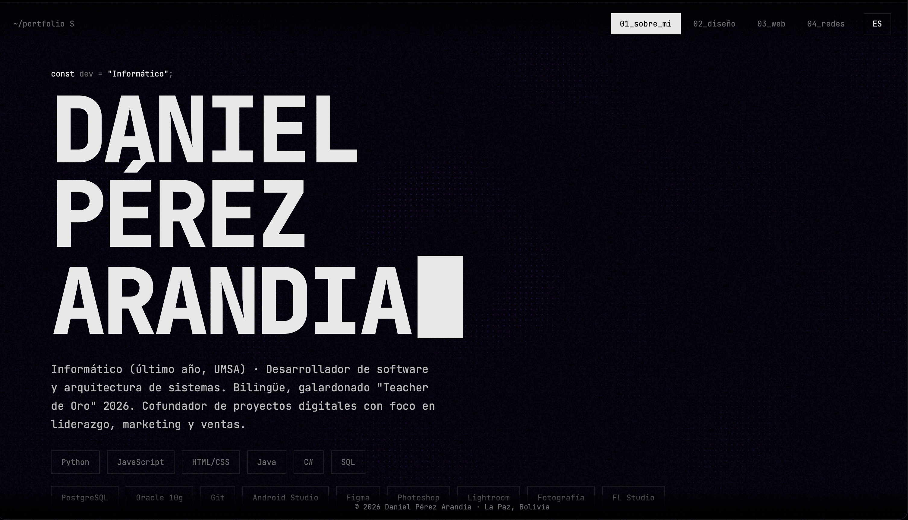

<div align="center">

```
 ┌──────────────────────────────────────────┐
 │  ~/portfolio $ whoami                    │
 │  > daniel_pérez_arandia█                 │
 └──────────────────────────────────────────┘
```

# DANIEL PÉREZ ARANDIA

**Informático · Desarrollador de Software · Fotografía & Diseño**


### [▶ Ver portafolio en vivo](https://dangonz2277-glitch.github.io/portfolio/)


</div>

---

## `> sobre_este_proyecto`

Portafolio personal de una sola página, con estética de terminal de IDE: tema negro monocromático, tipografía monoespaciada y un fondo de **puntillismo morado medianoche** que ondula con el mouse. El color lo ponen mis proyectos.

Sin frameworks ni dependencias. HTML, CSS y JavaScript puros.

## `> secciones`

| # | Sección | Contenido |
|---|---------|-----------|
| 01 | **Sobre mí** | Perfil, habilidades, experiencia, educación y premios |
| 02 | **Diseño gráfico** | Logos, identidad visual y piezas gráficas |
| 03 | **Páginas web** | Sitios que desarrollé o en los que colaboré |
| 04 | **Redes** | Fotografía profesional, personal y contacto |

## `> características`

- 🌌 **Fondo interactivo en Canvas:** ondas de puntos que reaccionan al mouse y a los clics.
- 🌊 **Transiciones entre secciones:** desenfoque, ondulación del fondo y aparición escalonada.
- ⌨️ **Estética de consola:** tipografía JetBrains Mono y cursor parpadeante.
- 🎞️ **Grano de película** en tono morado, animado con CSS.
- 🌐 **Bilingüe (ES / EN):** botón de idioma y detección automática del idioma del navegador.
- ⚡ **Optimizado:** dibujo por lotes, 30 fps (15 en reposo), pausa con la pestaña oculta y respeto a `prefers-reduced-motion`.
- 📱 **Responsive.**
- ⌨️ **Navegación con teclado:** flechas ← →.

## `> estructura`

```
portfolio/
├── index.html      # contenido y secciones
├── style.css       # tema, animaciones y layout
├── script.js       # fondo, transiciones e idioma
├── lang/
│   ├── es.js       # textos base en español
│   └── en.js       # traducción al inglés
└── img/            # imágenes de las tarjetas
```

## `> ejecutar_en_local`

```bash
git clone https://github.com/dangonz2277-glitch/portfolio.git
cd portfolio
```

Abre `index.html` en tu navegador. No requiere instalación ni servidor.

## `> idiomas`

Los textos viven en `lang/`. Para añadir o editar un idioma:

1. Copia `lang/es.js` como `lang/<codigo>.js`.
2. Cambia `LANG.es` por `LANG.<codigo>`.
3. Traduce solo los **valores**, sin tocar las claves ni las etiquetas HTML.

## `> personalizar`

| Qué | Dónde |
|-----|-------|
| Colores base | `:root` en `style.css` |
| Tono morado de los puntos | `fills` en `script.js` |
| Densidad del fondo | `const G` en `script.js` (más alto = menos puntos) |
| Intensidad del grano | `#grain { opacity }` en `style.css` |

## `> contacto`

<div align="center">

[](https://www.linkedin.com/in/daniel-perez-50bb01171)
[](https://www.instagram.com/by.arandia/)
[](https://www.instagram.com/perez_arandia/)
[](mailto:by.arandia27@gmail.com)

**La Paz, Bolivia**

<sub>© 2026 Daniel Pérez Arandia</sub>

</div>
